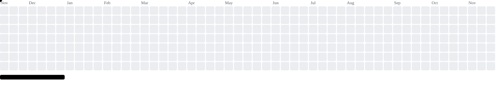

I'm studying CS at UMD.

Here's what I'm doing:

🤖 Nimbotics (Founder): shared robotics experiences

🛰️ MITRE (Software Engineer): mitre x umd adc

🎓 University of Maryland (TA - Software Development with GenAI): ai powered project grading automation x development

🔬 Waters Corporation (Engineering): r&d x infrastructure for fda-approved machines

🚗 Johns Hopkins APL (Engineering): vehicle automation + ml classifications

Love to build random things! Take a look! 👀

  
  &nbsp;&nbsp;
  

<!-- pacman -->
<picture>
    <source media="(prefers-color-scheme: dark)" srcset="https://raw.githubusercontent.com/adamzeineldin/adamzeineldin/output/breakout-contribution-graph-dark.svg">
    <source media="(prefers-color-scheme: light)" srcset="https://raw.githubusercontent.com/adamzeineldin/adamzeineldin/output/breakout-contribution-graph.svg">
    
</picture>
